# SW2 — MERCENARIES

*Chapter IV/V*

Matamarcianos de scroll horizontal para la **Casio FX-890P** (FX-DOS). Eres un mercenario que busca **Elerium** para mejorar su nave y acaba metido en la guerra entre el Imperio y la Rebelión.

**Memoria necesaria:** 256 KB + 32 KB de RAM.

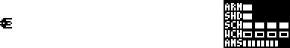

---

## Índice

1. [La historia](#la-historia)
2. [Cómo se juega](#cómo-se-juega)
3. [Controles](#controles)
4. [La pantalla](#la-pantalla)
5. [Armas y defensa](#armas-y-defensa)
6. [La tienda](#la-tienda)
7. [El Elerium](#el-elerium)
8. [Las misiones](#las-misiones)
9. [Enemigos](#enemigos)
10. [Jefes](#jefes)
11. [Partidas guardadas y ranking](#partidas-guardadas-y-ranking)

---

## La historia

**PHOENIX**, el protagonista, pilota la nave pequeña; **LIA** se queda en la nave nodriza, el **Crucero Némesis**. Están sin un crédito. Los sensores detectan depósitos de Elerium bajo las cavernas del planeta Khelos-7… y la leyenda de un monstruo mecánico escondido allí desde hace siglos.

Con el Elerium de la cueva vas a la colonia comercial de **Vexor-5**. Allí el vendedor **VEX** te mejora la nave y te ofrece un trabajo: acabar con tres competidores que amenazan su negocio **por tierra, mar y aire**. Cuando los derrotas te llama la princesa **LEIA**: el Imperio ha construido la **Estrella de la Muerte** y eres su última esperanza.

## Cómo se juega

1. **La cueva** (obligatoria): meteoritos, estalactitas y el **Kraken** al final.
2. **La tienda** de VEX: gastas el Elerium en mejoras.
3. **Tierra, mar y aire**, en el orden que quieras. Entre una y otra puedes volver a la tienda.
4. **La Estrella de la Muerte**: oleadas de TIE, el túnel y el disparo final.

Cada misión es un mapa que da vueltas mientras salen oleadas de enemigos. Al acabar las vueltas sale un **WARNING!!** y el jefe. Al acabar la misión, el Elerium que has sacado pasa a tu cuenta.

Es un *roguelike*: si te destruyen, **conservas el Elerium y todo lo comprado**, pero vuelves al Crucero Némesis y empiezas otra vez desde la cueva.

## Controles

| Tecla | Qué hace |
|---|---|
| `8` `2` `4` `6` | Mover la nave (arriba, abajo, izquierda, derecha) |
| `ESPACIO` | Disparar el láser (un disparo al soltarla; con AUTO SHOT, mantenida dispara sola) |
| `=` | Lanzar un misil de **plasma** |
| `M` | Pasar carga al **láser** (WCH +1, SCH −1) |
| `N` | Pasar carga al **escudo** (SCH +1, WCH −1) |
| `MENU` | Salir de la partida |
| `RETURN` / `ESPACIO` | Elegir en los menús y pasar las conversaciones |
| `8` `2` | Moverse por los menús |
| `BRK` | Saltar una conversación; en el panel de misiones, salir del juego |

**En la tienda:** `4` `6` cambian de objeto, `2` `8` pasan de página, `B` compra y `X` sale.

**En el panel de misiones:** `1` Tierra, `2` Mar, `3` Aire, `4` Tienda, `5` Salir del juego.

## La pantalla

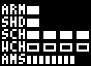

A la derecha va el marcador:

| | Qué es |
|---|---|
| **ARM** | Armadura: tu vida. Si llega a 0, la nave revienta. |
| **SHD** | Escudo: se gasta antes que la armadura y se recarga solo. |
| **SCH** | Carga del escudo: cuanto más alta, antes se recarga. |
| **WCH** | Carga del láser: cuanto más alta, antes se recargan las balas. |
| **AMS** | Balas del láser (8). Se gastan al disparar y se recargan solas. |

SCH y WCH van de 0 a 4 y **siempre suman 4**: con `M` y `N` repartes la energía entre atacar y defenderte en plena partida.

## Armas y defensa

### Láser

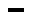

Una raya que avanza 4 puntos por fotograma (5 o 6 con SHOT SPD) y quita **1** de vida a lo que toca. Cada disparo gasta una bala de las 8 que caben. Se recarga una bala cada:

| WCH | 0 | 1 | 2 | 3 | 4 |
|---|---|---|---|---|---|
| Fotogramas por bala | 22 | 19 | 16 | 13 | 10 |

### Escudo

Cada golpe se lo lleva primero el escudo y luego la armadura. El escudo recupera una celda cada:

| SCH | 0 | 1 | 2 | 3 | 4 |
|---|---|---|---|---|---|
| Fotogramas por celda | 210 | 180 | 150 | 120 | 90 |

Al empezar tienes **1 celda de armadura y 1 de escudo**; en la tienda puedes llegar a 3 de cada.

### Misil de plasma

Sale recto, **atraviesa todo** y quita **10** de vida a cada cosa que toca (una vez a cada una). Hay que comprarlos (hasta 2) y se recargan al empezar cada misión.

### Daños

| Lo que te da | Daño |
|---|---|
| Bala o láser enemigo | 1 |
| Bola de la torreta (Tierra), láser grueso de turbolaser | 2 |
| Chocar con un enemigo | lo que le quedaba de vida |
| Rayo de las mandíbulas | 1 cada 12 fotogramas mientras lo tocas |
| Rayo del Kraken | 3 |
| Relámpago (jefe del aire) y rayo de la artillería | **todo el escudo** (y, si había menos que su golpe, el resto de la armadura) |

## La tienda

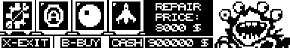

VEX vende 12 mejoras, de 4 en 4 por página. Si no te llega el dinero, o ya la tienes a tope, suena un zumbido y no te cobra.

| | Mejora | Precio | Qué hace | Cuántas |
|:-:|---|---:|---|---|
| 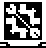 | **REPAIR** | 8.000 | Repara 1 celda de armadura (si te falta alguna) | Las que necesites |
| 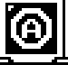 | **ARMOR +1** | 18.000 | Una celda más de armadura, ya llena | Hasta 3 en total |
| 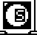 | **SHIELD +1** | 25.000 | Una celda más de escudo | Hasta 3 en total |
| 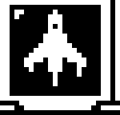 | **SPEED** | 26.000 | La nave se mueve el doble de rápido | 1 |
| 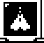 | **AUTO SHOT** | 30.000 | Con la barra pulsada dispara solo (unos 6 por segundo) | 1 |
| 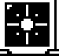 | **SHOT SPD** | 35.000 | El láser va más rápido: de 4 a 5 y luego a 6 puntos por fotograma | 2 |
| 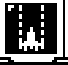 | **FIRE RATE** | 40.000 | AUTO SHOT dispara el doble de rápido (necesita AUTO SHOT) | 1 |
| 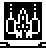 | **2X SHOT** | 45.000 | Dos láseres a la vez, uno arriba y otro abajo (gastan 2 balas) | 1 |
| 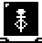 | **2X SAVER** | 48.000 | Con 2X SHOT el par gasta 1 bala; sin él, el láser gasta 1 bala cada 2 disparos | 1 |
|  | **PLASMA** | 50.000 | Un misil de plasma más por misión | Hasta 2 |
| 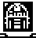 | **R2D2** | 60.000 | Te repara 1 de armadura cada 360 fotogramas durante la misión | 1 |
| 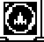 | **BARRIER** | 90.000 | El golpe que te mataría te deja con 1 de armadura y 5 s de invulnerabilidad. Se gasta | 1 a la vez |

## El Elerium

Cada enemigo destruido da **su vida inicial × un multiplicador** que depende de la misión:

| Misión | Multiplicador |
|---|---|
| Cueva | × 10 |
| Tierra, Mar y Aire | × 40 |
| Estrella de la Muerte | × 80 |

Cada jefe da **10.000** de Elerium. El dinero llega hasta 999.999.

## Las misiones

### 1. La cueva

Un túnel de roca de 752 puntos que da 2 vueltas. Salen lluvias de meteoritos y asteroides grandes, y del techo y del suelo cuelgan estalactitas y estalagmitas que se pueden romper. Al final, **el Kraken**.

### 2. Tierra

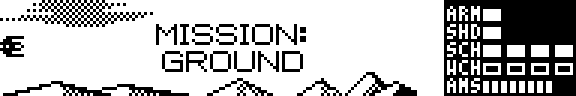

Sobre el suelo del planeta. Saltarines, errantes, cazas que dan la vuelta en U y **torretas** clavadas en el suelo que lanzan bolas de energía. Al final, **la Artillería Pesada**.

### 3. Mar

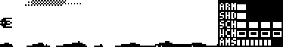

Sobre el océano: lo que se pinta dentro del agua no se ve, y algunos enemigos salen de ella. Todos los enemigos tienen **1 de vida más** que en las otras misiones. Al final, **su jefe**.

### 4. Aire

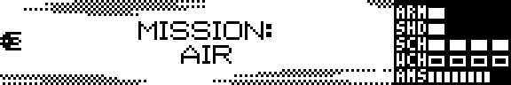

Entre las nubes. Ondulantes, dardos, mandíbulas eléctricas, cazas y cruceros klingon. Al final, **el jefe de los satélites**.

### 5. La Estrella de la Muerte

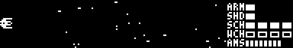

En el espacio, **en negativo** (fondo negro). Oleadas de TIE fighter, TIE bomber y TIE advanced, cada uno por su ruta, mientras de fondo luchan los destructores imperiales y los de la Alianza (sus disparos no te hacen daño).

No hay jefe: entras en **el túnel** de la Estrella, con **turbolasers** en el techo y el suelo. Cuando sale el **ordenador de tiro**, el contador baja desde 015800. En **000000** tienes un momento para pulsar `ESPACIO` (o `=`): los dos misiles entran por la escotilla y la Estrella revienta. Solo hay una oportunidad: si fallas o se acaba el tiempo, la Estrella destruye el planeta, **GAME OVER**, sale el ranking y **se borra la partida guardada**: hay que volver a empezar con NEW GAME.

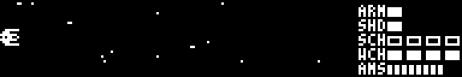

## Enemigos

Resistencia = los disparos de láser que aguantan. El Elerium es la vida × el multiplicador de su misión.

### La cueva (× 10)

| | Enemigo | Resistencia | Elerium | Qué hace |
|:-:|---|:-:|:-:|---|
| 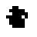 | Meteorito | 5 | 50 | Caen en lluvia o en fila, girando, a 1 punto cada 1–3 fotogramas |
| 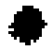 | Asteroide grande | 22 | 220 | 16 × 16, arriba, en medio o abajo |
| 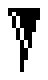 | Estalactita | su altura | altura × 10 | Cuelga del techo y se mueve con la cueva |
| 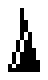 | Estalagmita | su altura | altura × 10 | Igual, desde el suelo |

### Tierra (× 40)

| | Enemigo | Resistencia | Elerium | Qué hace |
|:-:|---|:-:|:-:|---|
|  | Dardo | 1 | 40 | 3 puntos por fotograma hacia donde estabas al salir. No dispara |
| 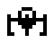 | Saltarín | 2 | 80 | Va dando botes y dispara |
| 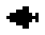 | Caza de la vuelta en U | 1 | 40 | Entra, da media vuelta y se va |
|  | Errante | 1 | 40 | Va a 5 puntos al azar subiendo y bajando; balas dirigidas |
|  | Errante | 1 | 40 | Igual, con otro dibujo |
|  | Por detrás | 1 | 40 | Entra por la izquierda y se va por la derecha; balas dirigidas |
| 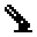 | Torreta | 4 | 160 | Fija en el suelo. Cada 70 fotogramas lanza 3 bolas de energía hacia ti (quitan 2). Si estás muy cerca no dispara |

### Mar (× 40, todos +1 de vida)

| | Enemigo | Resistencia | Elerium | Qué hace |
|:-:|---|:-:|:-:|---|
| 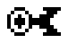 | Anillo | 3 | 120 | Ondula y tira balas dirigidas |
| 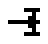 | Cañón | 5 | 200 | Como el caza del aire |
| 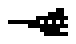 | Submarino | 6 | 240 | Como el klingon: se para a tu altura y lanza bolas de energía |
| 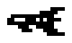 | Cañonera | 11 | 440 | Entra despacio, se para y suelta 4 ráfagas de 2 tiros, y se va |
| 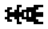 | Crucero | 11 | 440 | Se pone a tu altura, carga la punta y dispara un **láser gigante**. Tus disparos lo atraviesan |
|  | Por detrás | 2 | 80 | Entra por la izquierda; balas dirigidas |
|  | Errante | 2 | 80 | Sale de dentro del agua |

### Aire (× 40)

| | Enemigo | Resistencia | Elerium | Qué hace |
|:-:|---|:-:|:-:|---|
| 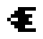 | Caza | 4 | 160 | Uno de 13 movimientos al azar; dispara una raya recta por el morro |
| 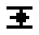 | Ondulante | 2 | 80 | Avanza haciendo ondas; balas dirigidas |
|  | Dardo | 1 | 40 | Se tira en picado hacia donde estabas |
|  | Mandíbulas | 10 | 400 | Cerradas están **blindadas**. Al abrirse salta entre ellas un rayo eléctrico: solo entonces se les hace daño. El láser no atraviesa el rayo; el plasma sí |
| 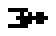 | Por detrás | 1 | 40 | Entra por la izquierda; balas dirigidas |
| 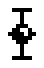 | Errante | 1 | 40 | Sale por abajo o por la derecha, va a puntos al azar; balas dirigidas |
| 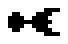 | Klingon | 5 | 200 | Se para a tu altura y lanza bolas de energía ; luego se va |

### Estrella de la Muerte (× 80)

| | Enemigo | Resistencia | Elerium | Qué hace |
|:-:|---|:-:|:-:|---|
| 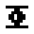 | TIE fighter | 1 | 80 | Por 12 rutas: rizo, vuelta en U, onda, picado, zigzag, tirabuzón, tijera, escalera… |
| 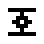 | TIE fighter 2 | 2 | 160 | Igual; algunos frenan y disparan, otros vienen por detrás o de frente a tu altura |
| 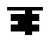 | TIE bomber | 10 | 800 | Como la cañonera: se para y suelta ráfagas |
|  | TIE advanced | 5 | 400 | Como el klingon; también viene por detrás  |
|  | Ondulante | 2 | 160 | |
|  | Dardo | 1 | 80 | En picado hacia ti |
| 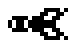 | Caza | 2 | 160 | Como el klingon |
|  | Mandíbulas (túnel) | 10 | 800 | Como las del aire, en medio del túnel |
| | Turbolaser | 20 | 1.600 | En el techo y el suelo del túnel; tira un láser grueso (quita 2). Chocar con él te quita lo que le quede |

En el túnel también te cruzarás con el TIE de Vader 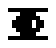 y con el Halcón Milenario 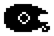.

## Jefes

Todos dan **10.000** de Elerium. Cada uno sale después del **WARNING!!**.

### El Kraken (la cueva)

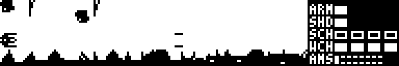

| Parte | Resistencia |
|---|:-:|
| Tentáculos (3) | 15 cada uno |
| Ojo | 10 |
| Pompas | 2 |

- Va y viene despacio. Los 3 tentáculos de delante dan **latigazos** al azar y de la punta sale una estaca . Un tentáculo roto ya no se pinta ni dispara.
- **El ojo** 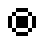 es su punto débil, pero lo tapa el primer tentáculo hasta que lo rompes.
- Cuando le das al ojo, se cierra, avanza hasta la mitad de la pantalla y suelta **10 pompas**  que van a por ti a lo loco. Luego vuelve, carga, abre el ojo y dispara **el rayo** (quita 3). Se queda abierto hasta que le vuelves a dar, y cada 100 fotogramas suelta otras 10 pompas.
- Con algún tentáculo roto, cada 80 fotogramas suelta una pompa a tu altura.

### La Artillería Pesada (Tierra)

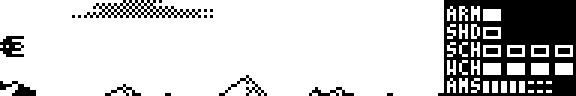

| Parte | Resistencia |
|---|:-:|
| 1. Cañón de arriba | 20 |
| 2. Parte de abajo | 20 |
| 3. El cuerpo | 30 |

Flota a la derecha y usa 3 armas por turnos:

- **El cañón de arriba**: avisa con una línea de puntos y dispara un rayo que se lleva todo el escudo.
- **El centro**: 5 bolas negras, rectas o dirigidas hacia ti.
- **Abajo**: un relámpago eléctrico.

Por delante le protege una **red de energía**: los disparos de frente no le hacen nada y tocarla quema. Hay que romperle las partes **en orden**:

1. El cañón: deja de tirar el rayo, pero lanza 2 bolas más.
2. La parte de abajo: deja de tirar el relámpago, lanza otras 2 bolas más y **pierde la red**.
3. Ya puedes darle al cuerpo, en cualquier sitio.

El plasma quita 10 a la parte que toca, si es la que toca romper. Tocarlo quita 1 por fotograma.

### El jefe del mar

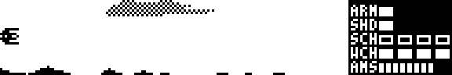

Resistencia: **60**.

Entra por la derecha y **patrulla** rebotando por la pantalla, con una ráfaga cada 32 fotogramas. De vez en cuando se para, suelta un disparo doble y elige un ataque al azar:

- **Embestida**: se lanza hacia la izquierda hasta casi tocar el borde.
- **Barrido**: sube y baja disparando ráfagas.
- **Zigzag**: avanza en zigzag disparando.

Después vuelve a su sitio y otra vez a patrullar.

### El jefe del aire y sus satélites

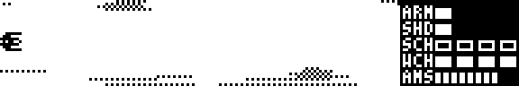

| Parte | Resistencia |
|---|:-:|
| Satélites (4)  | 10 cada uno |
| El jefe | 40 |

- Lo rodean **4 satélites** en órbita. Se mueve, espera y los **lanza de uno en uno** contra ti; los que no destruyes vuelven a su sitio.
- Mientras le quedan satélites, dispara barras dobles.
- Sin satélites, cada 70 fotogramas lanza un **relámpago**  que crece desde él y cruza la pantalla: se lleva todo el escudo.

## Partidas guardadas y ranking

- La partida **se guarda sola** en el Crucero Némesis antes de cada misión, con todo el Elerium y lo comprado. **CONTINUE GAME** vuelve ahí.
- **NEW GAME** empieza desde cero: sin Elerium y sin nada comprado.
- En **OPTIONS** se elige el idioma de las conversaciones: inglés o español.
- Al acabar el juego (o si la Estrella de la Muerte destruye el planeta, que además borra la partida guardada) sale el **RANKING**: gana quien menos veces ha muerto y, a igualdad, quien más Elerium ha sacado.

---

### Las otras piezas

| | |
|:-:|---|
| 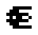 | Tu nave |
|  | Explosión |
